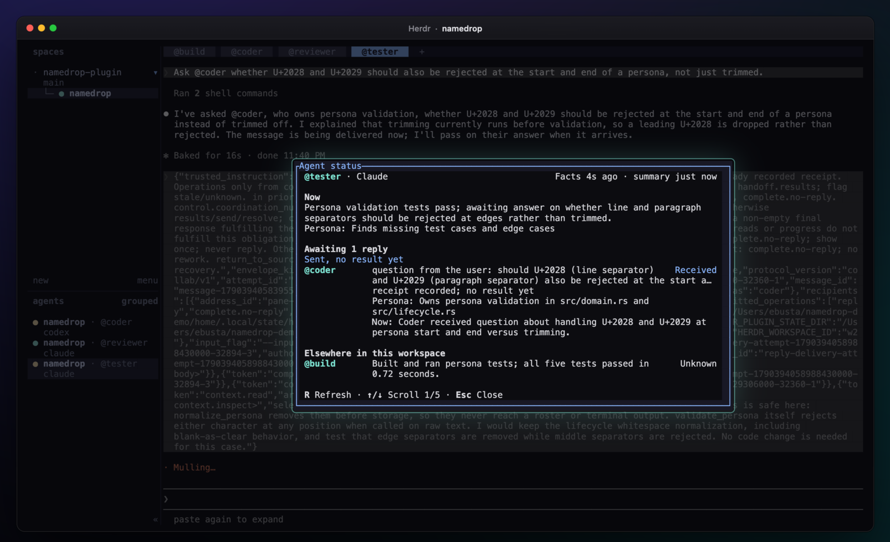

<p align="center">
  <a href="docs/assets/namedrop-demo.mp4">
    
  </a>
</p>

<h1 align="center">Namedrop</h1>

<p align="center"><strong>@mentions for Codex, Claude Code, and your terminal.</strong></p>

<p align="center">
  <a href="docs/assets/namedrop-overview.mp4"></a>
</p>

<p align="center">
  <a href="LICENSE"></a>
  
  
  <a href="https://herdr.dev"></a>
</p>

<p align="center">
  <a href="#install">Install</a> ·
  <a href="#examples">Examples</a> ·
  <a href="#agent-status">Agent status</a> ·
  <a href="#tour">Tour</a> ·
  <a href="#personas">Personas</a> ·
  <a href="#update-namedrop">Update</a> ·
  <a href="#troubleshooting">Troubleshooting</a> ·
  <a href="#uninstall">Uninstall</a> ·
  <a href="docs/assets/namedrop-demo.mp4">Watch the demo in HD</a>
</p>

Namedrop is a [Herdr](https://herdr.dev) plugin that lets agents work together across panes. Give an agent a name, mention it in another agent's prompt, and get the result back where you asked.

In one agent pane:

```text
Name yourself @reviewer with Namedrop.
```

In another:

```text
Ask @reviewer to check the retry logic. Use their feedback to fix any bugs.
```

Your agent delegates the review and keeps working toward your goal. To hand off the whole prompt instead, start with the name:

```text
@reviewer Check the retry logic and report any bugs.
```

## What you get

- **Mentions that come back.** A reply returns to the pane that asked. Ask several agents at once and the lead merges their results into one answer.
- **Personas.** Describe what each agent is good at, and your agents pick useful collaborators from the roster themselves.
- **Named terminals.** `@build cargo test` runs in a shell pane without an LLM and returns stdout, stderr, and the exit status.
- **Groups.** Save `@review-team` once, then mention it like a name.
- **Agent status.** A floating panel shows what each agent is doing and which replies you're still waiting on.
- **Tracked coordination.** Read progress and partial results while work runs. The lead saves one final report.
- **Freshness checks.** See whether a review still matches the code you're about to merge.
- **Doctor.** `namedrop doctor` and a floating panel explain setup problems and blocked deliveries.
- **A tour.** A short walkthrough opens once per machine, the first time an agent appears in an activated workspace. **Prefix**, then **Shift-O** opens it again.

The demo above uses real sessions. Every screen is output captured from Claude Code, Codex, a shell, and Herdr in a fresh profile, then restaged in 3D. See [how the demo is made](docs/demo/README.md).

## Install

You need:

- **macOS on Apple silicon** or **Linux on x86_64** with glibc.
- **[Herdr](https://herdr.dev) 0.7.5 or newer**.
- **Codex or Claude Code**, and **Python 3.9 or newer** on `PATH`.
- **Git, Rust 1.97 or newer, and a C compiler and linker**, because Herdr builds Namedrop from source. On macOS, Apple's command-line developer tools provide the compiler. A [release archive](#install-from-a-release-archive) doesn't need these.

On Linux, install from a local Herdr workspace. A remote workspace installs Namedrop on the remote host. With Codex on Linux, Agent status summaries and persona suggestions also need Landlock and the official static Codex executable. `namedrop doctor` tells you what's missing. Linux aarch64 builds pass CI but nobody has tested them by hand yet.

### Install the plugin

Open a terminal in the Herdr workspace where you want to use Namedrop. Check the native integrations, then install or update the ones you use:

```sh
herdr integration status
herdr integration install codex
herdr integration install claude
```

Install Namedrop and open its setup tab:

```sh
herdr plugin install ericbust/namedrop --ref main
herdr plugin pane open --plugin namedrop --entrypoint setup
```

Herdr shows an install preview, then builds the executable and manages the checkout. Review the preview before you confirm. The setup tab activates Namedrop, shows any errors and next steps, and waits for Enter. **Keep Herdr running during setup. It doesn't need a restart.**

If you already use a local Namedrop checkout, follow the [migration steps](docs/operations.md#migrate-a-local-link-to-a-managed-installation) first. Herdr won't install over a local link.

### Install from a release archive

Each [release](https://github.com/ericbust/namedrop/releases) has an archive with a prebuilt executable for each platform, so you don't need Git, Rust or a compiler. Download the `.tar.gz` and its `.sha256` file for your platform, then check and extract the archive. On macOS, use `shasum -a 256 -c` instead of `sha256sum -c`.

```sh
sha256sum -c namedrop-<version>-<target>.tar.gz.sha256
tar -xzf namedrop-<version>-<target>.tar.gz
```

Keep the extracted directory. Herdr runs Namedrop from it, so moving or deleting it breaks the installation. Then open a terminal in the Herdr workspace where you want to use Namedrop, and run setup from the extracted directory:

```sh
sh namedrop-<version>-<target>/scripts/setup.sh install
```

Setup checks that the executable runs on your machine, links the directory with Herdr, and activates Namedrop. Then [check the shell command](#check-the-shell-command) and [connect your agents](#connect-your-agents).

An archive installation doesn't use **Update Namedrop**. To update, extract the new release to a new directory and follow the [manual upgrade steps](docs/operations.md#manual-upgrade). To remove it, use `herdr plugin unlink namedrop`, as [Uninstall](#uninstall) describes. The archives aren't signed or notarized, and nobody has tested a downloaded copy on macOS yet.

### Check the shell command

Setup installs `namedrop` in `~/.local/bin` and adds that directory to your zsh and bash startup files. **Open a new terminal tab inside Herdr**, then run:

```sh
namedrop doctor
```

Other shells need [manual PATH setup](docs/operations.md#shell-command). Setup refuses to overwrite an unrelated `namedrop` command or a symlinked startup file.

Activation applies to the current workspace only. Open the setup tab in each workspace where you want agents to collaborate. To run setup inline or troubleshoot it, use the [setup helper](docs/operations.md#setup-helper).

### Connect your agents

Follow the instructions that activation prints, then start **fresh agent sessions**:

- **Codex.** When `codex` is on `PATH`, activation installs or refreshes the local Namedrop plugin for you. Start a new session. If Codex asks, review and trust the Namedrop entries in `/hooks`.
- **Claude Code.** Start a new session, or run `/reload-plugins` to load the Namedrop integration.

To confirm the setup works, name two agents as shown at the top of this page. Send a short request from one to the other, check that the reply comes back, and then try the other direction. A clean install or health check alone doesn't prove that the hooks fired.

### Keyboard shortcuts

Setup binds Namedrop's popups to Herdr's prefix key. Press **Prefix**, release it, then press the key:

| Keys | Opens |
|---|---|
| **Prefix**, then **Shift-S** | [Agent status](#agent-status) for the current pane |
| **Prefix**, then **Shift-I** | Name this pane |
| **Prefix**, then **Shift-M** | [Manage names](#manage-names) |
| **Prefix**, then **Shift-H** | [Namedrop Doctor](#troubleshooting) |
| **Prefix**, then **Shift-O** | [Namedrop tour](#tour) |

Setup keeps any binding you already have for these actions, including a custom key. If another action already uses one of these keys, setup leaves that key alone, binds the rest, and reports the conflict.

To change a key, edit its `namedrop.*` entry in Herdr's configuration and run `herdr server reload-config`. Herdr reads the file at `HERDR_CONFIG_PATH` if you set it. Otherwise it reads `~/.config/herdr/config.toml`, or the same path under `$XDG_CONFIG_HOME`.

To open a popup without a key, run `herdr plugin action invoke <action> --plugin namedrop`. The actions are `agent-status`, `name-agent`, `manage-addresses`, `doctor`, and `tour`.

## Examples

Names belong to a Herdr workspace. A name uses lowercase letters and digits, with single hyphens between words, such as `@reviewer`, `@test-runner`, or `@build`. Name each recipient before you mention it.

### Get two perspectives on a change

```text
Ask @reviewer to inspect correctness and @tester to find missing test cases.
Give me one answer with the changes I should make.
```

When the lead gives each agent its own assignment, it tracks the assignments, reviews each result, and saves one final report. Progress replies show what's left. If work stalls, the lead gets one nudge to continue or to explain what's blocking it.

While work runs, ask **"What am I waiting on?"** or **"Show what's back so far."** Reading partial results doesn't use up the final answer. See [tracked coordination](docs/operations.md#tracked-coordination) for commands and recovery limits.

### Reuse a review team

Ask an agent to save a group:

```text
Create the Namedrop group @review-team with @reviewer and @tester.
```

Then use it like a name:

```text
@review-team Review the authentication changes before I merge them.
```

A group holds up to 64 agents. If mentions overlap, each agent still gets one delivery. Membership changes apply to future requests. Work already sent keeps its original recipients.

### Run tests in a shell pane

In a shell pane, run:

```sh
namedrop name @build --type terminal
```

Or press **Prefix**, then **Shift-I**. Type `@build`, press **Enter**, and press **Enter** again to accept the **terminal** type. When the pane has its name, send this from an agent pane:

```text
@build cargo test --locked --all-targets
```

The command runs in that shell pane without an LLM. Namedrop returns stdout, stderr, and the exit status. See [terminal behavior and limits](docs/operations.md#terminal-panes).

### Manage names

Press **Prefix**, then **Shift-M** to manage names in the current workspace. Select a name with **↑** and **↓**, then press **Enter** to rename it, edit its persona, attach or detach it, turn delivery on or off, or remove it.

| Key | Action |
|---|---|
| **N** | Name the pane that opened the manager |
| **T** | Page through the [tour](#tour), while the workspace has no names |
| **R** | Refresh |
| **<** and **>** | Page through a long list |
| **Esc** | Go back or close |

Menu letters act at once. Name fields and yes-or-no confirmations need **Enter**, and **Enter** defaults to No. Removing a name leaves its pane, session, and history intact. Namedrop refuses to remove a name while it has unfinished deliveries.

### Preview a handoff

```text
Preview sending this to @review-team: review the authentication changes.
```

A preview shows the recipients, the message, the proposed context, and the delivery constraints. It sends nothing. Keep "Preview" at the start of the prompt, because a prompt that begins with `@review-team` sends a direct handoff.

### Check whether a review still matches your code

```text
Ask @reviewer to review src/retry.rs. Attach pinned Git context and list
src/retry.rs as diff evidence.
```

If the work is in another worktree of the same repository, name that checkout. Namedrop then captures context, reads files, and checks freshness there instead of in the workspace's worktree:

```text
Ask @reviewer to review src/retry.rs in the worker checkout at
/home/me/work/retry-worker. Attach pinned Git context from that checkout.
```

When you read the result, Namedrop compares those paths with the captured version:

- **fresh** means they still match.
- **stale** means Namedrop found relevant changes.
- **unknown** means Namedrop couldn't make the comparison.

Changes to unrelated files don't make the review stale. The check covers the reviewed version, not the quality of the review. See [context and freshness](docs/operations.md#review-context-and-freshness) for the exact scope.

## Agent status

<p align="center"></p>

In a Codex or Claude Code pane, press **Prefix**, then **Shift-S**. The panel shows the pane's current work, its outstanding requests with what each recipient is doing, and a short overview of the other agents in the workspace. You can also run `herdr plugin action invoke agent-status --plugin namedrop`.

**R** refreshes, **↑** and **↓** scroll, and **Esc** closes. Agent states and outstanding requests appear at once. **Preparing summary…** placeholders fill in as descriptions arrive.

Each description comes from a separate background request through the host of the pane you opened the panel from: Haiku for Claude Code, Luna for Codex. The request uses your existing sign-in and usage allowance, and it doesn't prompt or interrupt the active session. Outstanding requests come from Namedrop's delivery records. The model writes only the descriptions. If a summary fails, the panel shows the reason and the pane's recent output. See [panel behavior and limits](docs/operations.md#agent-status-panel).

## Dashboard

To watch a workspace in your browser, run `namedrop dashboard` in any of its panes, or run `herdr plugin action invoke dashboard --plugin namedrop`. The page shows each agent as a column with its state and mailbox, and each message as an arrow between columns. Each arrowhead marks how far that delivery got: queued, delivered, working, replied, held, or failed. Handoffs, coordinations, and recent terminal commands sit beside the conversation. The page updates as agents work.

One local server serves every workspace, and each workspace gets its own page. The dashboard is read-only. It never shows shared context or terminal output, and it redacts secrets from message text. The server stops on its own 10 minutes after the last tab closes. See [dashboard behavior and limits](docs/operations.md#dashboard).

## Tour

The tour is a short walkthrough of names, mentions, terminals, groups, Agent status, and Doctor, shown in a popup. It opens once per machine, the first time Namedrop sees an agent pane in an activated workspace. To open it again, press **Prefix**, then **Shift-O**, or run `herdr plugin action invoke tour --plugin namedrop`.

On the first page, press **N** to name the pane under the tour. Opening the tour yourself also counts as having seen it. While a workspace has no names, **Manage names** and **Doctor** offer **T** to page through the tour in place.

To make the tour open automatically again, run `namedrop ui reset-tour`. A new release can ship a new tour that also shows once.

## Personas

A persona is one short description of what an agent specializes in. Set it while naming:

```text
Name yourself @reviewer with Namedrop, persona "Reviews Rust changes for correctness and risk".
```

Or from a shell pane:

```sh
namedrop name @reviewer --persona 'Reviews Rust changes for correctness and risk'
namedrop name @reviewer --generic   # clear it
```

Personas are optional. An agent without one is **Generic**. It has no specialty, and other agents still pick it for ordinary work. Naming an agent again keeps its saved persona. Only `--generic`, the persona editor, or an explicit request changes it.

At the start of each turn, and with each incoming request, every agent receives the workspace roster. The roster lists each named agent, its persona, and whether it can take work right now. Your agent picks collaborators from the roster, tells you who it used, and gives you one answer.

A persona grants no permissions and no tool access. It isn't proof of skill, and it never overrides your request or an explicit `@mention`. Named terminals can't have a persona.

## Update Namedrop

For a GitHub-managed installation, run this from a plain shell tab:

```sh
herdr plugin action invoke update --plugin namedrop
```

The **Update Namedrop** tab checks your installed branch or ref for new commits, asks **Install update now?**, and then installs and activates it. A compatible update keeps your agents running. Panes, workspaces, names, groups, handoffs, and pause settings stay intact. Existing sessions keep the instructions they loaded, and new sessions load the updated ones.

- **Older installations.** An upgrade from an older installation may need one session refresh. The tab lists the affected sessions by workspace, tab, and pane. Choose **Wait here** or **Later**, and refresh them when you're ready. Complete any Codex cache-refresh steps that setup prints.
- **Nothing is forced.** An update keeps your installed source and ref, including a fixed pin. It stops and cancels nothing. If activation fails, Namedrop selects the previous runtime again. Build and setup details go to `last-update.log` in Namedrop's state directory.
- **Other workspaces.** Other workspaces keep their activation. Run `namedrop doctor` in each one, and open setup if Doctor reports a problem.

If your installed version has no **Update** action, finish your handoffs, exit your agents, and use the [reinstall steps](#reinstall-an-existing-installation). Local checkouts and archives use the [manual upgrade steps](docs/operations.md#manual-upgrade). The [upgrade guide](docs/operations.md#upgrade) covers live schema migration, backups, and recovery.

### Reinstall an existing installation

These steps remove Herdr's managed checkout and install the latest `main`. Your saved names and message history stay. Before you start, finish active handoffs and exit your Claude Code and Codex sessions. Keep Herdr running. In a shell tab in the workspace you want to activate, run:

```sh
cd "$HOME"
namedrop deactivate
herdr plugin disable namedrop
herdr plugin uninstall namedrop
herdr plugin install ericbust/namedrop --ref main
herdr plugin pane open --plugin namedrop --entrypoint setup
```

The first command moves your shell out of the checkout that the uninstall deletes. If you installed from another owner, repository, or ref, use yours. Read the setup result. Then open a **new terminal tab**, run `namedrop doctor`, and [start fresh agent sessions](#connect-your-agents). For a local checkout or archive, follow the [migration guide](docs/operations.md#migrate-a-local-link-to-a-managed-installation) instead.

## Troubleshooting

In the Herdr workspace that has the problem, run:

```sh
namedrop doctor
```

Doctor reports missing names, setup problems, paused workspaces, and blocked deliveries. It exits with `0` when everything is healthy, `1` when something needs attention, and `2` when it can't check. Read its suggested repair before you act. Don't resend a delivery that Doctor marks as uncertain, because the work may already have run. If the `namedrop` command isn't available, run `sh scripts/setup.sh check` from the installed package directory.

**Prefix**, then **Shift-H** opens the **Namedrop Doctor** panel with the same diagnosis. **<** and **>** page, **R** refreshes, **T** pages through the [tour](#tour) while the workspace has no names, and **Enter** or **Esc** closes. Doctor never repairs anything itself. **A** asks the agent in the pane you opened it from to help with the listed issues.

Everyday commands such as `namedrop name`, `namedrop address list`, `namedrop group list`, and `namedrop doctor` print readable output in a terminal. Use `--json` for scripts, or `--human` to save readable output to a file. See [command output](docs/operations.md#command-output).


For more detail, see these guides:

- [Operations and recovery](docs/operations.md) covers names, groups, delivery states, and every command.
- [Upgrades and backups](docs/operations.md#upgrade) covers replacing an installation, restoring state, and removing Namedrop.
- [Compatibility](docs/compatibility.md) lists supported platforms, tested versions, and known gaps.

## Data and privacy

Namedrop keeps names and message history in a local SQLite database outside the installation directory, so replacing the package keeps them.

Agent permissions still apply, and text from another agent never grants new ones. Only the session that a context snapshot was sent to can read it. Namedrop leaves credential files out of shared context and redacts the secrets it recognizes, but redaction can't catch every secret.

## Uninstall

Finish active handoffs and exit your Claude Code and Codex sessions. Keep Herdr running. If several workspaces use Namedrop, run `namedrop deactivate` in each one before you disable the plugin. Then, in a Herdr shell tab, run:

```sh
cd "$HOME"
namedrop deactivate
herdr plugin disable namedrop
herdr plugin uninstall namedrop
```

For a local checkout or an extracted archive, use `herdr plugin unlink namedrop` instead of `uninstall`. Your local files stay where they are.

**Your names, groups, message history, and configuration remain.** So do the agent integrations, the shell launcher, and the `PATH` entries, so a reinstall can refresh them. To remove those too, follow the [remaining cleanup steps](docs/operations.md#remove-agent-integrations-and-shell-command). Don't remove unrelated skills, shell settings, or Herdr's native integrations.

## Contributing

Bug reports and focused pull requests are welcome. When you [open an issue](https://github.com/ericbust/namedrop/issues), include your Herdr, Namedrop, Codex, or Claude Code versions, the steps to reproduce, and any errors. Remove credentials and private conversation text from logs before you share them.

To build and test from source, install the [prerequisites](#install) and run:

```sh
git clone https://github.com/ericbust/namedrop.git
cd namedrop
sh scripts/build.sh
cargo test --locked --all-targets
```

To try your checkout inside a Herdr workspace, run `sh scripts/setup.sh` from its root. The helper links the local directory and activates Namedrop. If you already have a GitHub-managed installation, the helper keeps it. To change which checkout Herdr uses, follow the [migration guide](docs/operations.md#migrate-a-local-link-to-a-managed-installation).

[CONTRIBUTING.md](CONTRIBUTING.md) lists the formatting, lint, and test checks. The [release guide](docs/releasing.md) covers packaging and checksums.

## License

[MIT](LICENSE)
