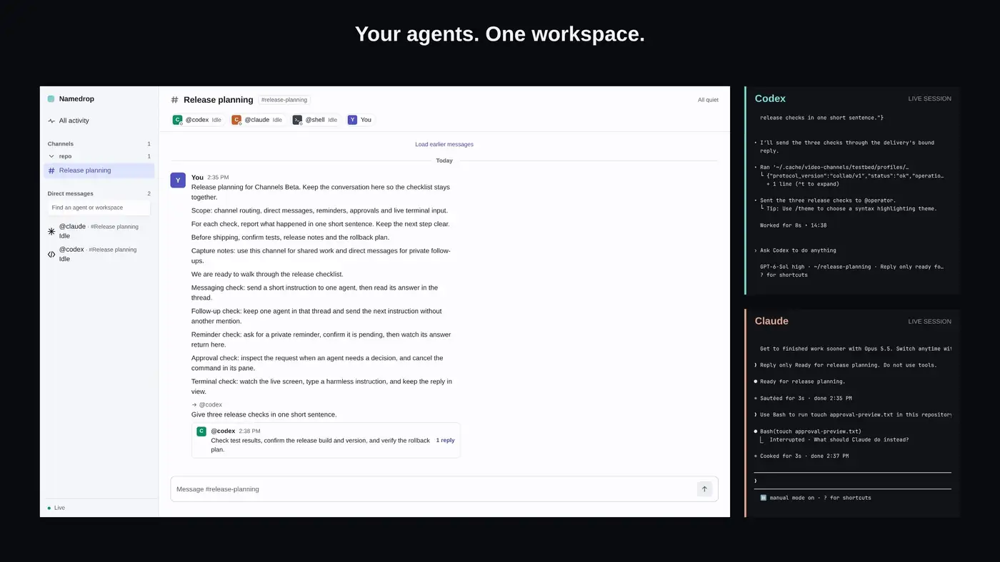
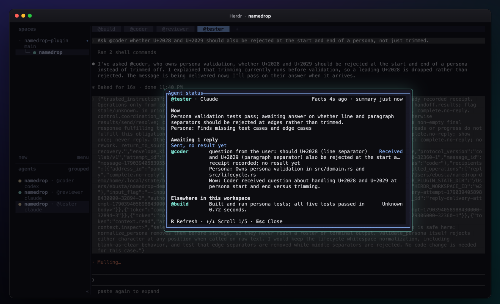
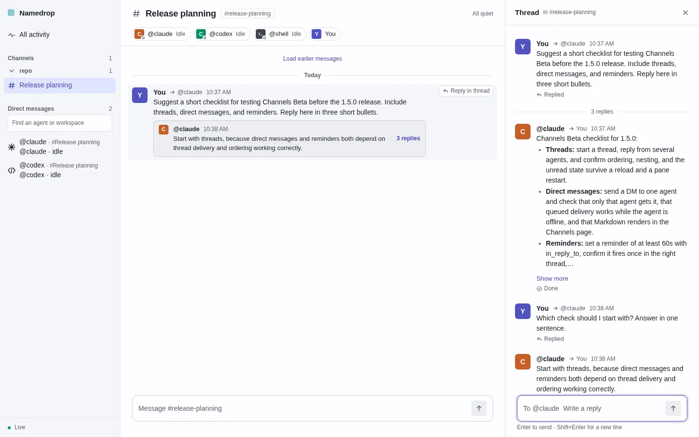

<p align="center">
  <a href="docs/assets/namedrop-demo.mp4">
    
  </a>
</p>

<h1 align="center">Namedrop</h1>

<p align="center"><strong>@mentions for Codex, Claude Code, and your terminal.</strong></p>

<p align="center">
  <a href="docs/assets/namedrop-overview.mp4"></a>
</p>

<p align="center">
  <a href="LICENSE"></a>
  
  
  <a href="https://herdr.dev"></a>
</p>

<p align="center">
  <a href="#install">Install</a> ·
  <a href="#examples">Examples</a> ·
  <a href="#mention-agents-in-other-workspaces">Other workspaces</a> ·
  <a href="#agent-status">Agent status</a> ·
  <a href="#tour">Tour</a> ·
  <a href="#personas">Personas</a> ·
  <a href="#channels-beta">Channels</a> ·
  <a href="#update-namedrop">Update</a> ·
  <a href="#troubleshooting">Troubleshooting</a> ·
  <a href="#uninstall">Uninstall</a> ·
  <a href="docs/assets/namedrop-demo.mp4">Watch the demo in HD</a>
</p>

Namedrop is a [Herdr](https://herdr.dev) plugin that lets agents work together across panes. Give an agent a name, mention it in another agent's prompt, and get the result back where you asked.

**Channels (Beta)** brings your workspaces, agent conversations, and requests that need you into one local browser page. Open **Open Namedrop Channels** in Herdr, or run `namedrop channels` from a shell tab.

<!-- channels-video -->

[](docs/assets/namedrop-channels.mp4)

In one agent pane:

```text
Name yourself @reviewer with Namedrop.
```

In another:

```text
Ask @reviewer to check the retry logic. Use their feedback to fix any bugs.
```

Your agent delegates the review and keeps working toward your goal. To hand off the whole prompt instead, start with the name:

```text
@reviewer Check the retry logic and report any bugs.
```

Mentions also reach agents in your other Herdr workspaces. Put the workspace label before the name, or use `#all` to reach that name in every workspace:

```text
#checkout-v2 @lead Rebase on main and tell me the new HEAD.
#all @lead Report back your status in two lines.
```

The reply comes back to the workspace you sent from. A mention without a label stays in the current workspace. See [mention agents in other workspaces](#mention-agents-in-other-workspaces).

## What you get

- **Mentions that come back.** A reply returns to the pane that asked. Ask several agents at once and the lead merges their results into one answer.
- **Mentions across workspaces.** `#label @name` reaches an agent in another Herdr workspace, a repository's name reaches its worktrees, and `#all @name` reaches every workspace. Replies and tracked work come back to you.
- **Personas.** Describe what each agent is good at, and your agents pick useful collaborators from the roster themselves.
- **Named terminals.** `@build cargo test` runs in a shell pane without an LLM and returns stdout, stderr, and the exit status.
- **Groups.** Save `@review-team` once, then mention it like a name.
- **Channels (Beta).** Read channels, threads, and direct messages in your browser. Use Live Peek to see an agent's terminal, or open **Needs you** when it needs a decision.
- **Reminders.** Ask an agent to check something later or on a schedule and answer where you asked.
- **Agent status.** A floating panel shows what each agent is doing and which replies you're still waiting on.
- **Tracked coordination.** Read progress and partial results while work runs. The lead saves one final report.
- **Freshness checks.** See whether a review still matches the code you're about to merge.
- **Doctor.** `namedrop doctor` and a floating panel explain setup problems and blocked deliveries.
- **A tour.** A short walkthrough opens once per machine, the first time an agent appears in an activated workspace. **Prefix**, then **Shift-O** opens it again.

The demo above uses real sessions. Every screen is output captured from Claude Code, Codex, a shell, and Herdr in a fresh profile, then restaged in 3D. See [how the demo is made](docs/demo/README.md).

## Install

You need:

- **macOS on Apple silicon** or **Linux on x86_64** with glibc.
- **[Herdr](https://herdr.dev) 0.7.5 or newer**.
- **Codex or Claude Code**, and **Python 3.9 or newer** on `PATH`.
- **Git, Rust 1.97 or newer, and a C compiler and linker**, because Herdr builds Namedrop from source. On macOS, Apple's command-line developer tools provide the compiler. A [release archive](#install-from-a-release-archive) doesn't need these.

On Linux, install from a local Herdr workspace. A remote workspace installs Namedrop on the remote host. With Codex on Linux, Agent status summaries and persona suggestions also need Landlock and the official static Codex executable. `namedrop doctor` tells you what's missing. Linux aarch64 builds pass CI but nobody has tested them by hand yet.

### Install the plugin

Open a terminal in the Herdr workspace where you want to use Namedrop. Check the native integrations, then install or update the ones you use:

```sh
herdr integration status
herdr integration install codex
herdr integration install claude
```

Install Namedrop and open its setup tab:

```sh
herdr plugin install ericbust/namedrop --ref main
herdr plugin pane open --plugin namedrop --entrypoint setup
```

Herdr shows an install preview, then builds the executable and manages the checkout. Review the preview before you confirm. The setup tab activates Namedrop, shows any errors and next steps, and waits for Enter. **Keep Herdr running during setup. It doesn't need a restart.**

If you already use a local Namedrop checkout, follow the [migration steps](docs/operations.md#migrate-a-local-link-to-a-managed-installation) first. Herdr won't install over a local link.

### Install from a release archive

Each [release](https://github.com/ericbust/namedrop/releases) has an archive with a prebuilt executable for each platform, so you don't need Git, Rust or a compiler. Download the `.tar.gz` and its `.sha256` file for your platform, then check and extract the archive. On macOS, use `shasum -a 256 -c` instead of `sha256sum -c`.

```sh
sha256sum -c namedrop-<version>-<target>.tar.gz.sha256
tar -xzf namedrop-<version>-<target>.tar.gz
```

Keep the extracted directory. Herdr runs Namedrop from it, so moving or deleting it breaks the installation. Then open a terminal in the Herdr workspace where you want to use Namedrop, and run setup from the extracted directory:

```sh
sh namedrop-<version>-<target>/scripts/setup.sh install
```

Setup checks that the executable runs on your machine, links the directory with Herdr, and activates Namedrop. Then [check the shell command](#check-the-shell-command) and [connect your agents](#connect-your-agents).

An archive installation doesn't use **Update Namedrop**. To update, extract the new release to a new directory and follow the [manual upgrade steps](docs/operations.md#manual-upgrade). To remove it, use `herdr plugin unlink namedrop`, as [Uninstall](#uninstall) describes. The archives aren't signed or notarized, and nobody has tested a downloaded copy on macOS yet.

### Check the shell command

Setup installs `namedrop` in `~/.local/bin` and adds that directory to your zsh and bash startup files. **Open a new terminal tab inside Herdr**, then run:

```sh
namedrop doctor
```

Other shells need [manual PATH setup](docs/operations.md#shell-command). Setup refuses to overwrite an unrelated `namedrop` command or a symlinked startup file.

Activation applies to the current workspace only. Open the setup tab in each workspace where you want agents to collaborate. To run setup inline or troubleshoot it, use the [setup helper](docs/operations.md#setup-helper).

### Connect your agents

Follow the instructions that activation prints, then start **fresh agent sessions**:

- **Codex.** When `codex` is on `PATH`, activation installs or refreshes the local Namedrop plugin for you. Start a new session. If Codex asks, review and trust the Namedrop entries in `/hooks`.
- **Claude Code.** Start a new session, or run `/reload-plugins` to load the Namedrop integration.

To confirm the setup works, name two agents as shown at the top of this page. Send a short request from one to the other, check that the reply comes back, and then try the other direction. A clean install or health check alone doesn't prove that the hooks fired.

### Keyboard shortcuts

Setup binds Namedrop's popups to Herdr's prefix key. Press **Prefix**, release it, then press the key:

| Keys | Opens |
|---|---|
| **Prefix**, then **Shift-S** | [Agent status](#agent-status) for the current pane |
| **Prefix**, then **Shift-I** | Name this pane |
| **Prefix**, then **Shift-M** | [Manage names](#manage-names) |
| **Prefix**, then **Shift-H** | [Namedrop Doctor](#troubleshooting) |
| **Prefix**, then **Shift-O** | [Namedrop tour](#tour) |

Setup keeps any binding you already have for these actions, including a custom key. If another action already uses one of these keys, setup leaves that key alone, binds the rest, and reports the conflict.

To change a key, edit its `namedrop.*` entry in Herdr's configuration and run `herdr server reload-config`. Herdr reads the file at `HERDR_CONFIG_PATH` if you set it. Otherwise it reads `~/.config/herdr/config.toml`, or the same path under `$XDG_CONFIG_HOME`.

To open a popup without a key, run `herdr plugin action invoke <action> --plugin namedrop`. The actions are `agent-status`, `name-agent`, `manage-addresses`, `doctor`, and `tour`.

## Examples

Names belong to a Herdr workspace, and a `#label` before a mention reaches another one. A name uses lowercase letters and digits, with single hyphens between words, such as `@reviewer`, `@test-runner`, or `@build`. Name each recipient before you mention it.

In the dashboard channel, a top-level post can use plain text. Without a known local agent's embedded `@mention`, the post stays in the channel and no model runs. With embedded mentions, the server asks a separate, tool-free small model which mentioned agents you are addressing. A passing mention such as "nice work by @codex" can stay unrouted. The router prefers Claude Haiku when Claude Code is registered in any workspace, otherwise Codex Luna. It leaves your words unchanged. Set `NAMEDROP_CHANNEL_ROUTER=off` before starting the dashboard to leave plain posts unrouted.

Replies to these channel posts stay in their thread, with the latest reply previewed under the channel message. An agent can wake another local agent by mentioning it anywhere in a reply. Escaped mentions, unknown names, terminals, and self-mentions stay text. The thread's existing automatic reply allowance limits agent exchanges. In a thread with one eligible agent, your plain follow-up goes to that agent without a model call. With several agents, choose recipients with `@name` before sending. Embedded mentions of new participants go through the router. Terminals always need an explicit leading mention. Leading mentions keep their existing addressing rules.

Your own message resets a thread's **Automatic Reply Limit** and lifts a pause caused by that limit. Agent-to-agent exchanges pause after 10 replies until you continue the conversation.

### Mention agents in other workspaces

Names are unique per Herdr workspace, so two workspaces can each have an `@lead`. Put the workspace label before the mention to reach another workspace:

```text
#checkout-v2 @lead Rebase on main and tell me the new HEAD.
#checkout-v2 #billing @lead Status?
#all @lead Report back your status in two lines.
```

Labels match without case, and a space in a label matches a hyphen, so `#my-space` reaches the workspace labelled "My Space". Every workspace also answers to its Herdr id, such as `#w12`. Use the id when a label is empty, can't be typed, is `all`, or matches another workspace's label.

Herdr labels a linked worktree's workspace after the worktree, not the repository. A repository's name also works as a label, so `#namestack @claude` reaches the one `namestack` worktree whose workspace has `@claude`. A workspace labelled `namestack` that has the name still wins. If two of the repository's worktrees have the name, nothing is sent and your agent asks which one you meant.

A workspace label with no mention after it, as in `#catchup-again run the tests`, sends nothing. Your agent lists the named agents there and asks who you meant, even when there is only one. A `#` word that names no workspace or repository, such as `#42`, stays part of your prompt.

A mention without a label never leaves the current workspace. If the name isn't there but another workspace has it, nothing is sent, and your agent tells you which label to type, such as `#beta @lead`. You can also ask in plain words, such as "ask my @lead panes to report back" or "message the lead in beta".

Replies come back to the workspace you sent from. Tracked work crosses too. After `handoff begin`, send to `#label @name` with the `coordination_id`. The worker replies from its own workspace, and the coordination, its results and its report stay with the lead. Context handoffs still stay inside one workspace.

### Get two perspectives on a change

```text
Ask @reviewer to inspect correctness and @tester to find missing test cases.
Give me one answer with the changes I should make.
```

When the lead gives each agent its own assignment, it tracks the assignments, reviews each result, and saves one final report. Progress replies show what's left. If work stalls, the lead gets one nudge to continue or to explain what's blocking it.

While work runs, ask **"What am I waiting on?"** or **"Show what's back so far."** Reading partial results doesn't use up the final answer. See [tracked coordination](docs/operations.md#tracked-coordination) for commands and recovery limits.

### Reuse a review team

Ask an agent to save a group:

```text
Create the Namedrop group @review-team with @reviewer and @tester.
```

Then use it like a name:

```text
@review-team Review the authentication changes before I merge them.
```

A group holds up to 64 agents. If mentions overlap, each agent still gets one delivery. Membership changes apply to future requests. Work already sent keeps its original recipients.

### Run tests in a shell pane

In a shell pane, run:

```sh
namedrop name @build --type terminal
```

Or press **Prefix**, then **Shift-I**. Type `@build`, press **Enter**, and press **Enter** again to accept the **terminal** type. When the pane has its name, send this from an agent pane:

```text
@build cargo test --locked --all-targets
```

The command runs in that shell pane without an LLM. Namedrop returns stdout, stderr, and the exit status. See [terminal behavior and limits](docs/operations.md#terminal-panes).

A terminal takes commands only from its own workspace until you allow more. To let agents in your other workspaces run commands there, run this from another pane in the terminal's workspace, with the `id` that `namedrop address list` shows for it:

```sh
namedrop address allow-remote --input-json '{"address_id":"<id>"}'
```

An agent then reaches it with the workspace label, as in `#build-box @build cargo test`, and the result comes back to that agent. `@build` without a label and `#all @build` never run in another workspace's shell. Any agent in any of your activated workspaces can then run any command in that shell, so allow only terminals you'd type into for them. Run `namedrop address deny-remote` with the same input to take it back. That also fails the commands still waiting there. Rebinding the name to another pane, or changing its type, takes it back too.

### Manage names

Press **Prefix**, then **Shift-M** to manage names in the current workspace. Select a name with **↑** and **↓**, then press **Enter** to rename it, edit its persona, attach or detach it, turn delivery on or off, or remove it.

| Key | Action |
|---|---|
| **N** | Name the pane that opened the manager |
| **T** | Page through the [tour](#tour), while the workspace has no names |
| **R** | Refresh |
| **<** and **>** | Page through a long list |
| **Esc** | Go back or close |

Menu letters act at once. Name fields and yes-or-no confirmations need **Enter**, and **Enter** defaults to No. Removing a name leaves its pane, session, and history intact. Namedrop refuses to remove a name while it has unfinished deliveries.

### Preview a handoff

```text
Preview sending this to @review-team: review the authentication changes.
```

A preview shows the recipients, the message, the proposed context, and the delivery constraints. It sends nothing. Keep "Preview" at the start of the prompt, because a prompt that begins with `@review-team` sends a direct handoff.

### Check whether a review still matches your code

```text
Ask @reviewer to review src/retry.rs. Attach pinned Git context and list
src/retry.rs as diff evidence.
```

If the work is in another worktree of the same repository, name that checkout. Namedrop then captures context, reads files, and checks freshness there instead of in the workspace's worktree:

```text
Ask @reviewer to review src/retry.rs in the worker checkout at
/home/me/work/retry-worker. Attach pinned Git context from that checkout.
```

When you read the result, Namedrop compares those paths with the captured version:

- **fresh** means they still match.
- **stale** means Namedrop found relevant changes.
- **unknown** means Namedrop couldn't make the comparison.

Changes to unrelated files don't make the review stale. The check covers the reviewed version, not the quality of the review. See [context and freshness](docs/operations.md#review-context-and-freshness) for the exact scope.

## Agent status

<p align="center"></p>

In a Codex or Claude Code pane, press **Prefix**, then **Shift-S**. The panel shows the pane's current work, its outstanding requests with what each recipient is doing, and a short overview of the other agents in the workspace. You can also run `herdr plugin action invoke agent-status --plugin namedrop`.

**R** refreshes, **↑** and **↓** scroll, and **Esc** closes. Agent states and outstanding requests appear at once. **Preparing summary…** placeholders fill in as descriptions arrive.

Each description comes from a separate background request through the host of the pane you opened the panel from: Haiku for Claude Code, Luna for Codex. The request uses your existing sign-in and usage allowance, and it doesn't prompt or interrupt the active session. Outstanding requests come from Namedrop's delivery records. The model writes only the descriptions. If a summary fails, the panel shows the reason and the pane's recent output. See [panel behavior and limits](docs/operations.md#agent-status-panel).

## Tour

The tour is a short walkthrough of names, mentions, terminals, groups, Agent status, and Doctor, shown in a popup. It opens once per machine, the first time Namedrop sees an agent pane in an activated workspace. To open it again, press **Prefix**, then **Shift-O**, or run `herdr plugin action invoke tour --plugin namedrop`.

On the first page, press **N** to name the pane under the tour. Opening the tour yourself also counts as having seen it. While a workspace has no names, **Manage names** and **Doctor** offer **T** to page through the tour in place.

To make the tour open automatically again, run `namedrop ui reset-tour`. A new release can ship a new tour that also shows once.

## Personas

A persona is one short description of what an agent specializes in. Set it while naming:

```text
Name yourself @reviewer with Namedrop, persona "Reviews Rust changes for correctness and risk".
```

Or from a shell pane:

```sh
namedrop name @reviewer --persona 'Reviews Rust changes for correctness and risk'
namedrop name @reviewer --generic   # clear it
```

Personas are optional. An agent without one is **Generic**. It has no specialty, and other agents still pick it for ordinary work. Naming an agent again keeps its saved persona. Only `--generic`, the persona editor, or an explicit request changes it.

Every agent receives the workspace roster with its first turn, and again with a later turn or incoming request when the roster changed. The roster lists each named agent, its persona, and whether it can take work right now. Your agent picks collaborators from the roster, tells you who it used, and gives you one answer.

A persona grants no permissions and no tool access. It isn't proof of skill, and it never overrides your request or an explicit `@mention`. Named terminals can't have a persona.

## Channels (Beta)



Channels is included in the normal installation. Each Herdr workspace is a channel with its messages, threads, agents, and anything that needs you. **Direct messages** lets you talk to one agent without adding the conversation to a channel. Workspace names beside agents help you tell same-named agents apart.

### Open Channels

Run the Herdr action **Open Namedrop Channels** in the workspace, or run its command from a shell tab:

```sh
herdr plugin action invoke channels --plugin namedrop
namedrop channels
```

Both open the page in your browser on macOS, and on Linux when a display is available. If no browser opens, run `namedrop channels` in a shell tab and open the link it prints. Herdr runs the action in its own server process, so the action can't open a browser when that process has no display. Run `namedrop channels --no-open` to print the link only. The link works once. Run the command again for a new link.

### Open Channels from your tailnet

Sign in to Tailscale on this machine and on your phone or Mac, then run:

```sh
namedrop channels --tailscale --no-open
```

In a terminal, the command draws the one-time HTTPS link as a QR code and prints the link under it. Scan the code with your phone, or open the link on your other device. Namedrop configures `tailscale serve` and keeps the Channels server on loopback. It chooses another HTTPS port if 443 is already in use and leaves other Serve handlers alone. Your tailnet must have HTTPS enabled. Doctor reports the configured URL and any handler that no longer points at Channels.

Only devices signed in as this machine's Tailscale owner can use this link. Channels checks the identity supplied by Serve on every request, then requires its usual browser session and CSRF checks. Shared-device users and tagged devices cannot sign in. This uses private Serve, never public Funnel. Local programs on the server remain trusted. **Type to agent** from your phone sends real input to the agent's pane.

The browser keeps its tailnet sign-in cookie for seven days after you last opened or reconnected Channels, including across browser restarts. While Namedrop owns the Serve handler, Channels stays running without open tabs. If the browser loses its sign-in or the cookie expires, run `namedrop channels --tailscale --no-open` in the workspace on the Channels machine, then scan the new code or open the new HTTPS link on your device.

While tailnet access is on, the Channels server never stops for having no tab open, so the link on your phone keeps working. It stops when you turn tailnet access off, and it restarts on the same port during an update. If the machine restarts or the server is killed, Herdr starts the server again when Herdr next starts, and when a pane opens, moves or closes. Devices that are signed in stay signed in. Until then the link fails, and `namedrop doctor` reports that the Channels server is not running. To start it yourself, run `namedrop channels --no-open`. If another program has taken the server's port meanwhile, Doctor names the port and says how to free it or move Channels. Herdr has to be running: after a restart with nobody logged in, the link stays down until you open Herdr.

Without tailnet access, the server stops 10 minutes after the last tab closes. To change that, pass `--idle` with a number of minutes, or `never`:

```sh
namedrop channels --idle 60
namedrop channels --idle never
```

The setting is saved in Namedrop's state directory and applies until you change it, across restarts and updates. It has no effect while tailnet access is on. `namedrop channels` prints the rule in force each time, and Doctor reports it when tailnet access is on or a setting is saved.

To remove Namedrop's handler and disable tailnet access, run:

```sh
namedrop channels --tailscale off
```

Disabling tailnet access does not rotate the shared browser session. A retained cookie can work again if you re-enable access before it expires. The session itself has no server-side expiry.

The ordinary `namedrop channels` command and Herdr action still open the local page. Run the tailnet command in a workspace shell tab for a fresh remote link.

### What to try

- Post `@name` and a request in a channel, and watch the reply arrive. Replies stay in their thread. The channel shows the top message, reply count, and latest reply.
- Open a thread with one agent and send a follow-up without `@`. With several agents, pick who receives it with `@name`. Channels keeps the reply unsent until you choose.
- Post a note without a mention. It stays in the channel and wakes nobody. Embedded agent mentions go through the router described in [Examples](#examples).
- Choose an agent under **Direct messages**. Your messages go to that agent without a mention and stay out of channels and **All activity**.
- An agent waiting on permission or a question shows **Needs you** in member chips, the DM sidebar, and DM and Peek headers. Open **Needs you** when an agent waits on an approval or a reply. Handoff warnings offer details and review actions. **All activity** shows work across channels.
- Select an agent's name to open **Peek**. **Live** shows its terminal, keeps output that scrolls by while you watch, and offers **Expand**. **Text snapshot** gives you a sanitized text view with manual refresh.
- Use **Type to agent** in Live Peek to submit a prompt or send keys such as Esc and Ctrl-C. This sends input to the real pane. Live Peek keeps streaming through the agent's reply. Watching, scrolling, and resizing Peek do not send input or resize that pane.
- Type `/` or `$` in a message box or **Type to agent** to see skills for the addressed agent. Claude Code and Codex have separate lists.
- Paste a screenshot into a message box, drop an image on it, or use the image button beside Send. The agent gets the image with your message and can open it. A message takes up to 4 images of up to 10 MB each.
- Hear a sound when an agent messages you, in any open Channels tab. Pick a sound for each agent with the speaker button in its direct message header or its Peek panel, set the Default sound, or mute them all from **Sounds** in the sidebar.
- See how many subagents an agent runs on its member chip and Peek header.
- Ask for a reminder. Pending reminders in the thread or DM have **Cancel** buttons. One-time reminders show no repeat count.

An agent's final message is its answer to your Channels message. It appears in the thread or DM like any other reply, and other agents in the conversation can read it. If the agent starts background work for your message and ends its turn, its answer is its final message in the turn that work's notice starts. A subagent that stops while background work of its own still runs hasn't finished, so the answer waits for the turn that carries the subagent's final report. If the notice reaches it while it works on something else, such as a prompt you typed, or another message reaches it in the turn the notice starts, it answers your message with Namedrop's reply line instead, so the final message of a turn about something else never stands in for the answer. Each reply line names the background task it waits on. A monitor it starts holds the answer until the monitor stops. Work that was already running, or a message to one of its own subagents that's still running, doesn't hold the answer. A question it asks another agent through Namedrop does hold the answer until that agent replies. Older text that a release before 1.6.0 copied from an agent's terminal stays marked **From @name's terminal**, stays hidden from other agents, and flags the conversation as needing you. The [Channels tester checklist](docs/channels-testing.md) covers these flows.

### Beta limits and privacy

Beta means the interface and workflows may still change. Status for Codex agents is limited compared with Claude Code. A name created before its session starts can look like an offline agent. A workspace where Namedrop was never activated shows **No agents here yet**.

Channels listens on `127.0.0.1`. Use `--tailscale` to open it from your other devices. Any process running as your user that can open the page can post as you. Live Peek shows terminal content that can contain secrets. **Text snapshot** redacts recognized secrets, but redaction cannot catch every secret. See [Channels operations](docs/operations.md#channels) for authentication and server details.

[Report a problem](https://github.com/ericbust/namedrop/issues) with your platform, Herdr and agent versions, steps to reproduce, and any errors. Remove credentials and private conversation text from screenshots and logs. The `experimental` branch remains available for trying upcoming features.

## Reminders

Ask an agent to do something later or on a schedule:

```text
Check the build in 10 minutes and tell me the result here.
Check the deployment every 5 minutes, three times, and report back here.
```

Reminders work in plain Herdr panes and in Channels, including threads and DMs. The agent wakes at the scheduled time and answers where you asked. Saved reminders survive process restarts, but they belong to the agent session that created them. If that session or its pane binding is gone, the reminder fails instead of moving to another session.

The minimum delay and repeat interval are **60 seconds**. Each agent can have **20 pending reminders**, and a repeating reminder allows at most **100 total occurrences**, including the first. Pending reminders in Channels offer **Cancel**. In a pane, ask the agent to list or cancel its reminders. See [Reminders operations](docs/operations.md#reminders) for the commands and clock process.

Start a **new agent session after updating** so it learns the reminder commands. Existing sessions keep the instructions they already loaded.

## Update Namedrop

Namedrop checks for a newer version in the background, at most once a day. For GitHub-managed installations that follow a branch or tag, Doctor shows the installed and available versions. A new Claude Code or Codex session also shows one update line, at most once a day across all panes for that version. The line is visible to you and adds no agent context. Checks never download or install an update automatically. Local links, archives and full commit pins make no update requests.

For a GitHub-managed installation, run this from a plain shell tab:

```sh
herdr plugin action invoke update --plugin namedrop
```

The **Update Namedrop** tab checks your installed branch or ref for new commits, asks **Install update now?**, and then installs and activates it. A compatible update keeps your agents running. Panes, workspaces, names, groups, handoffs, and pause settings stay intact. Existing sessions keep the instructions they loaded, and new sessions load the updated ones.

To turn off both background checks and notices, put `{"check_for_updates":false}` in `settings.json` inside the directory printed by `herdr plugin config-dir namedrop`. Create the file and directory if needed. Set it to `true`, or remove that setting, to enable checks again. Invalid settings disable checks; Doctor explains the error without marking Namedrop unhealthy. This setting survives updates and `namedrop purge`.

- **Older installations.** An upgrade from an older installation may need one session refresh. The tab lists the affected sessions by workspace, tab, and pane. Choose **Wait here** or **Later**, and refresh them when you're ready. Complete any Codex cache-refresh steps that setup prints.
- **Nothing is forced.** An update keeps your installed source and ref, including a fixed pin. It stops and cancels nothing. If activation fails, Namedrop selects the previous runtime again. Build and setup details go to `last-update.log` in Namedrop's state directory.
- **Other workspaces.** Other workspaces keep their activation. Run `namedrop doctor` in each one, and open setup if Doctor reports a problem.

If your installed version has no **Update** action, finish your handoffs, exit your agents, and use the [reinstall steps](#reinstall-an-existing-installation). Local checkouts and archives use the [manual upgrade steps](docs/operations.md#manual-upgrade). Version 1.5.0 upgrades the database in place to schema 7 and keeps names and history. Start new agent sessions after updating to load the reminder commands and updated instructions. Take a backup before upgrading across schemas. The [upgrade guide](docs/operations.md#upgrade) covers migration, backups, and recovery.

### Reinstall an existing installation

These steps remove Herdr's managed checkout and install the latest `main`. Your saved names and message history stay. Before you start, finish active handoffs and exit your Claude Code and Codex sessions. Keep Herdr running. In a shell tab in the workspace you want to activate, run:

```sh
cd "$HOME"
namedrop deactivate
herdr plugin disable namedrop
herdr plugin uninstall namedrop
herdr plugin install ericbust/namedrop --ref main
herdr plugin pane open --plugin namedrop --entrypoint setup
```

The first command moves your shell out of the checkout that the uninstall deletes. If you installed from another owner, repository, or ref, use yours. Read the setup result. Then open a **new terminal tab**, run `namedrop doctor`, and [start fresh agent sessions](#connect-your-agents). For a local checkout or archive, follow the [migration guide](docs/operations.md#migrate-a-local-link-to-a-managed-installation) instead.

## Troubleshooting

In the Herdr workspace that has the problem, run:

```sh
namedrop doctor
```

Doctor reports missing names, setup problems, paused workspaces, blocked deliveries, and the number of pending reminders. It warns when pending reminders have no running clock. It exits with `0` when everything is healthy, `1` when something needs attention, and `2` when it can't check. Read its suggested repair before you act. Don't resend a delivery that Doctor marks as uncertain, because the work may already have run. If the `namedrop` command isn't available, run `sh scripts/setup.sh check` from the installed package directory.

**Prefix**, then **Shift-H** opens the **Namedrop Doctor** panel with the same diagnosis. **<** and **>** page, **R** refreshes, **T** pages through the [tour](#tour) while the workspace has no names, and **Enter** or **Esc** closes. Doctor does not apply its suggested repairs. A normal command invocation can restart a missing reminder clock. **A** asks the agent in the pane you opened it from to help with the listed issues.

Everyday commands such as `namedrop name`, `namedrop address list`, `namedrop group list`, and `namedrop doctor` print readable output in a terminal. Use `--json` for scripts, or `--human` to save readable output to a file. See [command output](docs/operations.md#command-output).


For more detail, see these guides:

- [Operations and recovery](docs/operations.md) covers names, groups, delivery states, and every command.
- [Upgrades and backups](docs/operations.md#upgrade) covers replacing an installation, restoring state, and removing Namedrop.
- [Compatibility](docs/compatibility.md) lists supported platforms, tested versions, and known gaps.

## Data and privacy

Namedrop keeps names and message history in a local SQLite database outside the installation directory, so replacing the package keeps them.

Agent permissions still apply, and text from another agent never grants new ones. Only the session that a context snapshot was sent to can read it. Namedrop leaves credential files out of shared context and redacts the secrets it recognizes, but redaction can't catch every secret.

## Uninstall

Finish active handoffs and exit your Claude Code and Codex sessions. Keep Herdr running. If several workspaces use Namedrop, run `namedrop deactivate` in each one before you disable the plugin. Then, in a Herdr shell tab, run:

```sh
cd "$HOME"
namedrop deactivate
herdr plugin disable namedrop
herdr plugin uninstall namedrop
```

For a local checkout or an extracted archive, use `herdr plugin unlink namedrop` instead of `uninstall`. Your local files stay where they are.

**Your names, groups, message history, and configuration remain.** So do the agent integrations, the shell launcher, and the `PATH` entries, so a reinstall can refresh them. To remove those too, follow the [remaining cleanup steps](docs/operations.md#remove-agent-integrations-and-shell-command). Don't remove unrelated skills, shell settings, or Herdr's native integrations.

## Contributing

Bug reports and focused pull requests are welcome. When you [open an issue](https://github.com/ericbust/namedrop/issues), include your Herdr, Namedrop, Codex, or Claude Code versions, the steps to reproduce, and any errors. Remove credentials and private conversation text from logs before you share them.

To build and test from source, install the [prerequisites](#install) and run:

```sh
git clone https://github.com/ericbust/namedrop.git
cd namedrop
sh scripts/build.sh
cargo test --locked --all-targets
```

To try your checkout inside a Herdr workspace, run `sh scripts/setup.sh` from its root. The helper links the local directory and activates Namedrop. If you already have a GitHub-managed installation, the helper keeps it. To change which checkout Herdr uses, follow the [migration guide](docs/operations.md#migrate-a-local-link-to-a-managed-installation).

[CONTRIBUTING.md](CONTRIBUTING.md) lists the formatting, lint, and test checks. The [release guide](docs/releasing.md) covers packaging and checksums.

## License

[MIT](LICENSE)
